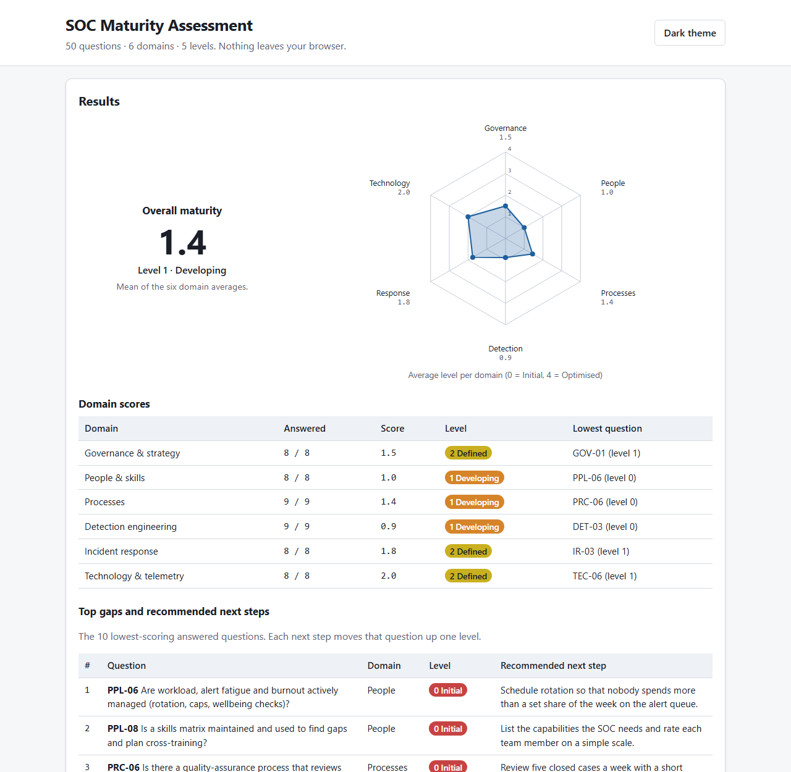

# SOC Maturity Assessment Tool

[](LICENSE) [](https://github.com/bizidwassim-design/soc-maturity-assessment/actions/workflows/ci.yml) [](SECURITY.md)

A free, open-source **self-assessment for security operations**: 50 questions across 6 domains, scored on
5 maturity levels, with a radar chart, a ranked gap list and a concrete next step for every gap.
It is a single static page: no build, no server, no account, no telemetry. Open `index.html` and start.



> 🇫🇷 Résumé en français en bas de page.

## Layout

```
index.html              the app (one page, strict Content-Security-Policy, no external resources)
assets/
  app.js                scoring, radar chart (inline SVG), gap table, export/import, draft storage, theme
  style.css             CSS tokens, light/dark theme, print stylesheet, system fonts
data/
  questions.js          the question bank: 50 questions, 6 domains, 5 level texts + 4 next steps each
  questions.csv         the same bank as CSV (generated)
  sample.js             fictional "Northwind Logistics" answers used by the Load sample button and ?sample=1
examples/
  northwind-sample.json a complete export in the app's JSON format (generated) — use it to test Import
docs/
  maturity-model.md     level definitions per domain and the evidence that supports each level
  using-the-results.md  how to turn the gap list into a 12-month roadmap
  screenshot*.png       what it looks like
scripts/
  check_questions.js    CI check: 50 questions, 6 domains, complete levels and next steps, unique ids
  build_data.js         regenerates data/questions.csv and examples/northwind-sample.json
```

## Quick start

1. Download or clone the repository and open `index.html` in any modern browser (it also works from a
   file share or GitHub Pages).
2. Click **Load the Northwind Logistics sample** to see a completed assessment, or start answering.
3. For each question pick the level that describes your SOC **today** and that you could prove with an
   artefact. Add the artefact in *Notes and evidence* if you want it in the export.
4. Read the **Results**: overall score, score per domain, radar, and the ten weakest questions with the
   step that moves each of them up one level.
5. **Export JSON** to keep a dated record (`soc-maturity-<org>-<date>.json`). Re-import it later to compare
   or continue. **Print** gives a clean PDF with only the selected answers.

Hosted on GitHub Pages? Append `?sample=1` to the URL to open the demo directly.

Your draft is kept in this browser's `localStorage` until you click **Reset answers**. Nothing is ever
sent anywhere: the page's Content-Security-Policy forbids network requests altogether.

## What's inside

| Domain | Questions | Covers |
|--------|-----------|--------|
| Governance & strategy | 8 (`GOV-01` … `GOV-08`) | Charter, strategy and roadmap, service catalogue and SLAs, metrics, budget, threat-led priorities, regulatory mapping, provider governance |
| People & skills | 8 (`PPL-01` … `PPL-08`) | Staffing and coverage, roles and progression, training, onboarding, knowledge base, workload and burnout, exercises, skills matrix |
| Processes | 9 (`PRC-01` … `PRC-09`) | Triage, escalation, case management, handover, playbooks, quality assurance, change control, vulnerability coordination, improvement loop |
| Detection engineering | 9 (`DET-01` … `DET-09`) | Detection lifecycle, ATT&CK coverage, detection as code, testing, tuning, threat intelligence, use-case prioritisation, documentation, threat hunting |
| Incident response | 8 (`IR-01` … `IR-08`) | IR plan, containment authority, forensics and evidence, communications, post-incident reviews, automation, exercises, notification duties |
| Technology & telemetry | 8 (`TEC-01` … `TEC-08`) | Log coverage, parsing and data quality, platform health, EDR, identity telemetry, cloud and SaaS telemetry, context enrichment, retention |

### The five levels

| Level | Name | In one sentence |
|-------|------|-----------------|
| 0 | Initial | Depends on individuals; nothing written; would stop if the key person left. |
| 1 | Developing | Partly written or partly deployed; not approved or not applied consistently. |
| 2 | Defined | Documented, approved and followed most of the time. |
| 3 | Managed | Measured and reviewed on a cadence; deviations are visible and acted on. |
| 4 | Optimised | Improved continuously from evidence; automated where sensible; adapts to change. |

Full definitions per domain and the evidence to look for: [docs/maturity-model.md](docs/maturity-model.md).

### Scoring

* **Domain score** = mean of the answered questions in that domain (0–4).
* **Overall score** = mean of the six domain scores, so each domain carries the same weight.
* **Gap list** = the ten answered questions with the lowest level (ties broken by domain order), each with
  the recommended step from its current level to the next one.
* Unanswered questions are excluded, and the results say how many were answered, so a partial assessment
  is still readable.

### Export format

```json
{
  "schema": "soc-maturity-assessment/1.0",
  "organisation": "Northwind Logistics",
  "assessment_date": "2026-10-15",
  "overall_score": 1.43,
  "overall_level": "Developing",
  "domains": { "governance": { "score": 1.5, "answered": 8, "total": 8 }, "...": {} },
  "answers": { "GOV-01": 1, "GOV-02": 1, "...": 0 },
  "notes":   { "GOV-01": "Draft charter written in Q2, waiting for CIO sign-off." },
  "top_gaps": [ { "id": "PPL-06", "level": 0, "next_step": "Schedule rotation so that…" } ]
}
```

Only `answers` is required for import; unknown ids and out-of-range values are ignored and reported.
See [examples/northwind-sample.json](examples/northwind-sample.json).

## Design choices

* **No framework, no bundler, no CDN.** One HTML file, one CSS file, two JS files. It will still open in ten years.
* **Strict CSP** (`default-src 'none'`) in a meta tag: no inline scripts or styles, no network. The CI job
  fails if an external resource is introduced.
* **Radar chart in inline SVG**, drawn by the app, so it inherits the theme and prints as vector.
* **Question bank as data.** `data/questions.js` is the single source of truth; the CSV and the sample export
  are generated and CI checks they are current. Translate or extend the bank without touching the app.
* **Next steps move one level**, not to the top. A roadmap built from the gap list is therefore realistic.
* **Accessible by default:** native radios and labels, `<progress>`, skip link, focus styles, `aria-live` status,
  honours `prefers-color-scheme` with a manual override.
* **Privacy:** the draft stays in `localStorage` (wrapped in `try/catch` for private browsing); the assessor
  field asks for a role, not a name.

## How it relates to the sibling repositories

| Repository | Relationship |
|------------|--------------|
| [soc-detection-playbooks](https://github.com/bizidwassim-design/soc-detection-playbooks) | The Sigma rules and playbooks are a concrete way to raise `DET-*` and `PRC-05` levels. |
| [ciso-executive-dashboard](https://github.com/bizidwassim-design/ciso-executive-dashboard) | Report the overall and domain scores there as a trend KPI. |
| [grc-control-crosswalk](https://github.com/bizidwassim-design/grc-control-crosswalk) | Map `GOV-07` obligations to controls across frameworks. |
| [iso27001-iso42001-toolkit](https://github.com/bizidwassim-design/iso27001-iso42001-toolkit) | ISMS documents (incident procedure, logging policy) that back the `IR-*` and `TEC-*` answers. |
| [application-risk-assessment-template](https://github.com/bizidwassim-design/application-risk-assessment-template) | The critical-asset view that `GOV-06` and `DET-07` depend on. |
| [public-scripts](https://github.com/bizidwassim-design/public-scripts) | Scripts for the telemetry and identity checks behind `TEC-04`, `TEC-05`. |

## Contributing

Better wording, new next steps, translations and accessibility fixes are welcome — see
[CONTRIBUTING.md](CONTRIBUTING.md) and the [Code of Conduct](CODE_OF_CONDUCT.md). Run
`node scripts/check_questions.js` and `node scripts/build_data.js` before opening a pull request.

## Disclaimer

A self-assessment measures what you can prove, not what you intend. Scores depend on the honesty and
evidence discipline of the assessors; use the model in `docs/maturity-model.md` to calibrate. This tool
supports, but does not replace, an independent assessment, a certification audit or professional advice.
All sample data is fictional.

## License

[MIT](LICENSE) — free to use, copy, modify and redistribute.

---

## 🇫🇷 Résumé

Outil **open source d'auto-évaluation de la maturité d'un SOC** : 50 questions réparties en 6 domaines
(gouvernance et stratégie, personnes et compétences, processus, ingénierie de détection, réponse aux incidents,
technologie et télémétrie), notées sur 5 niveaux (0 Initial à 4 Optimisé). Page web statique sans serveur ni
dépendance : scores par domaine et global, graphique radar, liste des 10 écarts les plus importants avec la
prochaine étape recommandée, export et import JSON, impression propre, brouillon conservé dans le navigateur.
Les données d'exemple (« Northwind Logistics ») sont fictives. Les libellés sont en anglais ; les traductions
sont bienvenues. Licence MIT.
